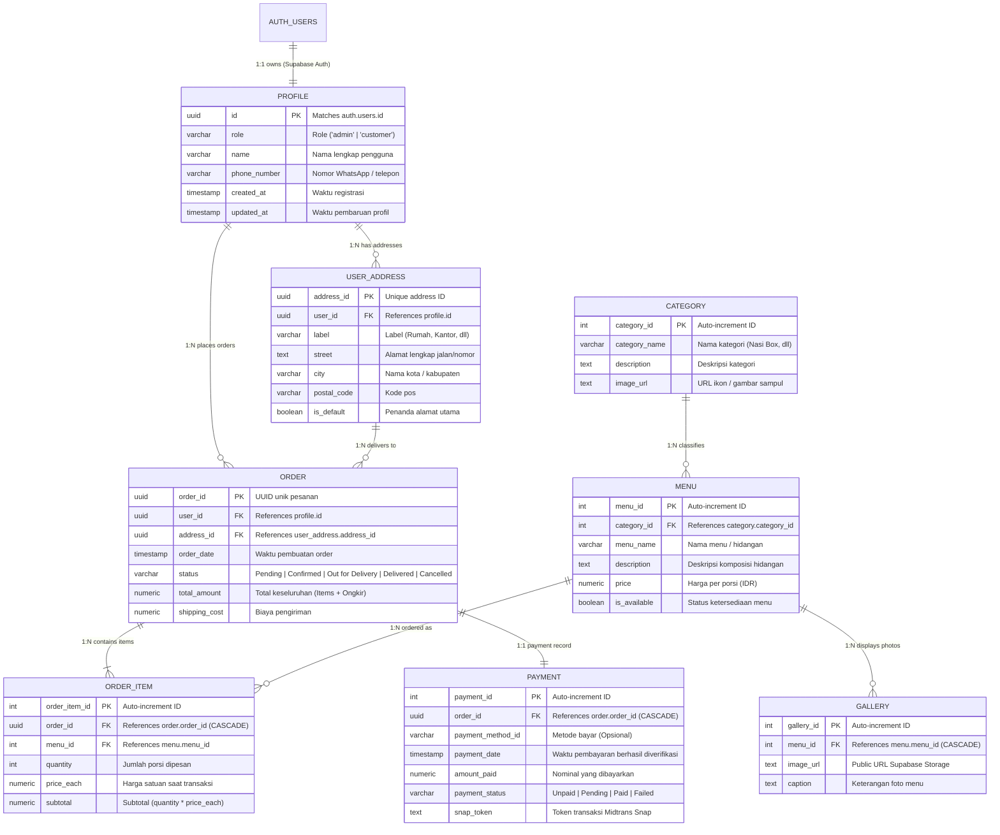

# 🗄️ Skema Database & ERD (Database Schema)

Dokumen ini mendeskripsikan struktur relasional basis data PostgreSQL yang di-host pada platform Supabase untuk aplikasi **Dapur Nekti (MJ Kitchen)**, mencakup diagram entitas relasi (ERD), definisi kamus data (*data dictionary*), constraint, dan trigger.

---

## 1. Entity Relationship Diagram (ERD)

---

## 2. Kamus Data (Data Dictionary)

### 2.1. Tabel `profile`
Menyimpan atribut profil pengguna publik yang terikat langsung dengan `auth.users` di Supabase.

| Kolom | Tipe Data | Nullable | Default | Keterangan |
|---|---|---|---|---|
| `id` | `UUID` | **NO** | - | Primary Key, merujuk ke `auth.users.id` (ON DELETE CASCADE) |
| `name` | `VARCHAR(255)` | **NO** | - | Nama lengkap pelanggan atau admin |
| `phone_number` | `VARCHAR(50)` | YES | `NULL` | Nomor telepon / nomor kontak WhatsApp |
| `role` | `VARCHAR(20)` | **NO** | `'customer'` | Nilai valid: `'admin'` atau `'customer'` |
| `created_at` | `TIMESTAMPTZ` | **NO** | `NOW()` | Waktu pembuatan akun |
| `updated_at` | `TIMESTAMPTZ` | YES | `NULL` | Waktu pembaruan data akun |

> **Catatan Alur Sinkronisasi**: Email disimpan di `auth.users` Supabase. Pada query backend `auth.js`, jika record profil belum terbentuk di PostgreSQL saat login pertama kali, middleware backend menyertakan fallback insert otomatis dengan nilai role `'customer'`.

---

### 2.2. Tabel `user_address`
Menyimpan buku alamat (*address book*) milik pelanggan untuk pengiriman pesanan.

| Kolom | Tipe Data | Nullable | Default | Keterangan |
|---|---|---|---|---|
| `address_id` | `SERIAL` / `UUID` | **NO** | - | Primary Key |
| `user_id` | `UUID` | **NO** | - | Foreign Key ke `profile(id)` (ON DELETE CASCADE) |
| `label` | `VARCHAR(100)` | **NO** | - | Label alamat (misal: "Rumah", "Kantor", "Gedung A") |
| `street` | `TEXT` | **NO** | - | Detail alamat jalan, nomor rumah, RT/RW, kelurahan |
| `city` | `VARCHAR(100)` | **NO** | - | Nama kota / kabupaten (digunakan juga untuk kalkulasi ongkir) |
| `postal_code` | `VARCHAR(20)` | YES | `NULL` | Kode pos |
| `is_default` | `BOOLEAN` | **NO** | `false` | Menandai apakah alamat ini merupakan alamat pengiriman utama |

> **Logika Default**: Ketika alamat ditandai `is_default = true`, sistem menjalankan perintah SQL untuk mereset seluruh alamat lain milik `user_id` tersebut menjadi `is_default = false` sebelum menyimpan.

---

### 2.3. Tabel `category`
Menyimpan kelompok klasifikasi menu makanan.

| Kolom | Tipe Data | Nullable | Default | Keterangan |
|---|---|---|---|---|
| `category_id` | `SERIAL` / `INT` | **NO** | - | Primary Key |
| `category_name` | `VARCHAR(100)` | **NO** | - | Nama kategori makanan (contoh: "Nasi Box", "Tumpeng", "Snack Box") |
| `description` | `TEXT` | YES | `NULL` | Deskripsi penjelasan paket kategori |
| `image_url` | `TEXT` | YES | `NULL` | URL gambar sampul/banner kategori |

---

### 2.4. Tabel `menu`
Menyimpan item hidangan/makanan yang tersedia untuk dipesan.

| Kolom | Tipe Data | Nullable | Default | Keterangan |
|---|---|---|---|---|
| `menu_id` | `SERIAL` / `INT` | **NO** | - | Primary Key |
| `category_id` | `INT` | **NO** | - | Foreign Key ke `category(category_id)` |
| `menu_name` | `VARCHAR(255)` | **NO** | - | Nama hidangan makanan |
| `description` | `TEXT` | YES | `NULL` | Komposisi lauk, deskripsi rasa, dan porsi |
| `price` | `NUMERIC(12,2)` | **NO** | - | Harga jual per porsi dalam Rupiah |
| `is_available` | `BOOLEAN` | **NO** | `true` | `true` = menu tampil dan dapat dipesan, `false` = stok habis / nonaktif |

> **Konvensi Add-On**: Item add-on (seperti extra sambal, nasi tambahan, kerupuk) juga disimpan di tabel `menu` dengan kriteria harga `<= 10000` atau memiliki kata kunci nama menu `%tambah%`, `%extra%`, `%add%`.

---

### 2.5. Tabel `gallery`
Menyimpan relasi 1:N gambar/foto makanan untuk setiap item menu.

| Kolom | Tipe Data | Nullable | Default | Keterangan |
|---|---|---|---|---|
| `gallery_id` | `SERIAL` / `INT` | **NO** | - | Primary Key |
| `menu_id` | `INT` | **NO** | - | Foreign Key ke `menu(menu_id)` (ON DELETE CASCADE) |
| `image_url` | `TEXT` | **NO** | - | URL publik gambar yang tersimpan di Supabase Storage (`menu-images`) |
| `caption` | `VARCHAR(255)` | YES | `NULL` | Keterangan tambahan atau label gambar |

---

### 2.6. Tabel `order`
Menyimpan pesanan induk dari pelanggan.

| Kolom | Tipe Data | Nullable | Default | Keterangan |
|---|---|---|---|---|
| `order_id` | `UUID` | **NO** | - | Primary Key (UUID v4) |
| `user_id` | `UUID` | **NO** | - | Foreign Key ke `profile(id)` |
| `address_id` | `UUID` / `INT` | YES | `NULL` | Foreign Key ke `user_address(address_id)` |
| `order_date` | `TIMESTAMPTZ` | **NO** | `NOW()` | Waktu pemesanan dilakukan |
| `status` | `VARCHAR(50)` | **NO** | `'Pending'` | Status pesanan: `Pending`, `Confirmed`, `Processing`, `Out for Delivery`, `Delivered`, `Cancelled` |
| `total_amount` | `NUMERIC(14,2)` | **NO** | - | Total tagihan akhir: Subtotal item + `shipping_cost` |
| `shipping_cost` | `NUMERIC(12,2)` | **NO** | `0` | Biaya ongkos kirim berdasarkan perhitungan jarak |

---

### 2.7. Tabel `order_item`
Menyimpan rincian item-item menu dan kuantitas dalam suatu pesanan.

| Kolom | Tipe Data | Nullable | Default | Keterangan |
|---|---|---|---|---|
| `order_item_id` | `SERIAL` / `INT` | **NO** | - | Primary Key |
| `order_id` | `UUID` | **NO** | - | Foreign Key ke `order(order_id)` (ON DELETE CASCADE) |
| `menu_id` | `INT` | **NO** | - | Foreign Key ke `menu(menu_id)` |
| `quantity` | `INT` | **NO** | `1` | Jumlah porsi makanan yang dipesan |
| `price_each` | `NUMERIC(12,2)` | **NO** | - | *Snapshot* harga satuan menu saat order dibuat |
| `subtotal` | `NUMERIC(14,2)` | **NO** | - | Hasil perkalian `quantity * price_each` |

---

### 2.8. Tabel `payment`
Menyimpan informasi transaksi pembayaran dan integrasi Midtrans Snap.

| Kolom | Tipe Data | Nullable | Default | Keterangan |
|---|---|---|---|---|
| `payment_id` | `SERIAL` / `INT` | **NO** | - | Primary Key |
| `order_id` | `UUID` | **NO** | - | Foreign Key ke `order(order_id)` (ON DELETE CASCADE) |
| `payment_method_id` | `VARCHAR(50)` | YES | `NULL` | Metode pembayaran (opsional) |
| `payment_date` | `TIMESTAMPTZ` | YES | `NULL` | Timestamp kapan status berubah menjadi `'Paid'` |
| `amount_paid` | `NUMERIC(14,2)` | **NO** | - | Nilai uang yang wajib/sudah dibayar |
| `payment_status` | `VARCHAR(50)` | **NO** | `'Unpaid'` | Status bayar: `'Unpaid'`, `'Pending'`, `'Paid'`, `'Failed'` |
| `snap_token` | `TEXT` | YES | `NULL` | Token transaksi Snap yang di-generate oleh Midtrans SDK |

---

## 3. Aturan Relasi & Integritas Data

1. **Cascade Delete pada Menu**:
   - Jika satu baris di tabel `menu` dihapus oleh Admin, seluruh baris terkait di tabel `gallery` akan dihapus secara otomatis (`ON DELETE CASCADE`).
2. **Cascade Delete pada Order**:
   - Jika order dihapus, seluruh data `order_item` dan `payment` yang terikat pada `order_id` tersebut akan terhapus otomatis.
3. **Immutability Harga Order Item**:
   - Kolom `price_each` pada tabel `order_item` mencatat harga menu saat transaksi terjadi. Perubahan harga menu di kemudian hari pada tabel `menu` tidak akan mengubah data historis pesanan yang telah berlalu.
