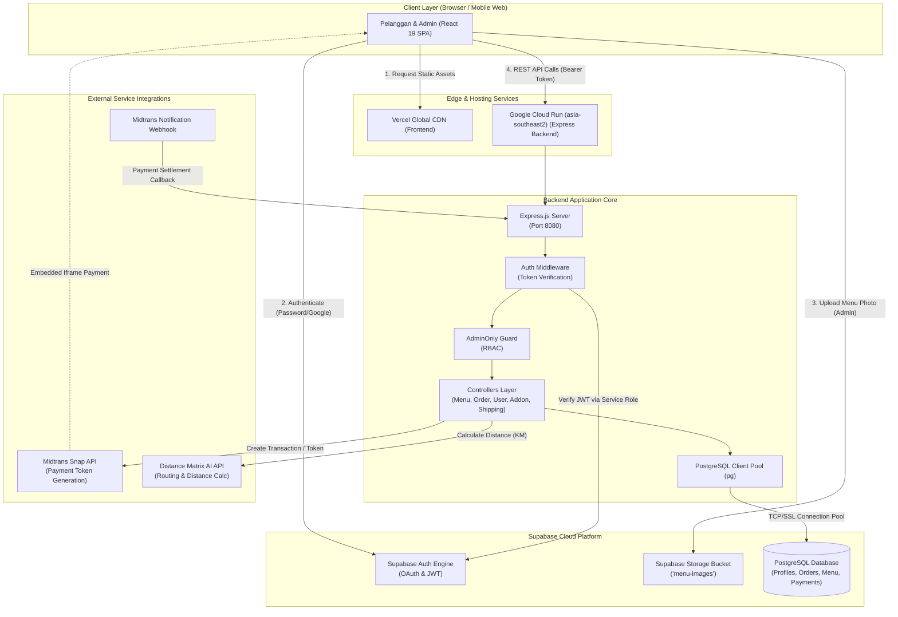
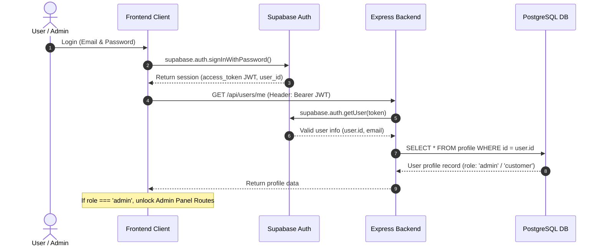

# 🏛️ Arsitektur Sistem (System Architecture)

Dokumen ini menjelaskan rancangan arsitektur tingkat tinggi (*high-level architecture*), topologi infrastruktur, pola komunikasi antar layanan, dan sistem keamanan dari platform **Dapur Nekti (MJ Kitchen)**.

---

## 1. Topologi Sistem (System Topology)

Arsitektur aplikasi mengadopsi model **Decoupled Client-Server (SPA & Headless REST API)** dengan dukungan layanan terkelola cloud (*Serverless & BaaS*).

---

## 2. Komponen Utama Sistem

### 2.1. Frontend Web Client (React 19 + Vite)
- **Teknologi**: React 19, Vite, Tailwind CSS, Zustand, React Router DOM v7.
- **Hosting**: Vercel (Edge Network) dengan routing SPA yang didelegasikan melalui file `vercel.json` (`rewrites: [{ source: "/(.*)", destination: "/index.html" }]`).
- **Tanggung Jawab**:
  - Rendering UI/UX antarmuka pengguna pelanggan dan dashboard administrator.
  - Manajemen state lokal (keranjang belanja, otentikasi) yang tahan refresh melalui `localStorage`.
  - Integrasi Midtrans Snap JS SDK melalui dynamic DOM injection (`window.snap.embed`).
  - Komunikasi HTTP ke backend API dengan injeksi otomatis access token Bearer.

### 2.2. Backend REST API Server (Node.js + Express)
- **Teknologi**: Node.js v18+, Express.js (ESM Module), `pg` (node-postgres), `@supabase/supabase-js`, `midtrans-client`.
- **Hosting**: Google Cloud Run (Region `asia-southeast2` - Jakarta) berbasis *containerless buildpacks* dari repository GitHub.
- **Tanggung Jawab**:
  - Menyediakan endpoint RESTful JSON untuk katalog menu, alamat, keranjang checkout, pelaporan, dan manajemen profil.
  - Menjalankan transaksi ACID database untuk pembuatan pesanan dan item terkait.
  - Memverifikasi otentikasi token JWT pengguna menggunakan *Supabase Service Role Key*.
  - Melakukan validasi hak akses (*Role-Based Access Control* - RBAC) untuk rute administratif.
  - Memproses webhook asinkron dari Midtrans untuk pembaruan status pembayaran otomatis.
  - Mengkalkulasi tarif ongkir berdasarkan koordinat origin dapur dan alamat tujuan via Distance Matrix AI API.

### 2.3. Database & BaaS (Supabase)
- **Teknologi**: PostgreSQL 15+ terkelola di Supabase.
- **Komponen**:
  1. **Relational DB**: Menyimpan data tabel `profile`, `user_address`, `category`, `menu`, `gallery`, `order`, `order_item`, dan `payment`.
  2. **Auth Service**: Mengelola user credentials, password hashing, Google OAuth, session token refresh, dan lifecycle identity.
  3. **Storage**: Bucket publik `menu-images` untuk menyimpan foto-foto resolusi tinggi dari item menu dan galeri hidangan.

### 2.4. Payment Gateway (Midtrans)
- **Mode**: Snap API (Embedded Popup Payment) & Core API (Webhook listener & status checking).
- **Alur Kerja**:
  1. Backend menghasilkan `snap_token` saat order dibuat.
  2. Frontend menampilkan modal pembayaran Snap langsung di browser pelanggan tanpa redirect.
  3. Setelah bayar, Midtrans mengirimkan HTTP POST Notification Webhook ke endpoint `/api/orders/midtrans-notification`.
  4. Backend memverifikasi tanda tangan transaksi dan memperbarui status order menjadi `Confirmed` dan status payment menjadi `Paid`.

### 2.5. Distance Matrix AI
- Digunakan untuk menghitung jarak tempuh jalan raya nyata (*driving distance*) antara alamat origin dapur:
  `Setiabudi Regency no.G 110, Cihideung, Parongpong, Bandung Barat`
  ke alamat tujuan pelanggan.
- Jarak (dalam km) kemudian dikonversi ke tarif ongkir dinamis (`Math.ceil(distanceKm * 3000)` dengan tarif dasar minimum Rp 10.000).

---

## 3. Desain Keamanan & Otorisasi (Security Architecture)

### 3.1. Proteksi Token & Stateless Authentication
- Token otentikasi berupa JWT yang diterbitkan oleh Supabase Auth.
- Backend tidak menyimpan session di memori (*stateless*), melainkan memvalidasi token pada setiap request menggunakan `supabase.auth.getUser(token)`.
- Backend memegang `SUPABASE_SERVICE_ROLE_KEY` di environment variabel rahasia yang tidak pernah diekspos ke publik atau frontend.

### 3.2. Role-Based Access Control (RBAC)
- Setiap akun memiliki record di tabel `profile` dengan kolom `role`:
  - `customer`: Hanya dapat mengakses data pribadi (profil sendiri, alamat sendiri, pesanan sendiri) dan katalog publik.
  - `admin`: Memiliki hak penuh untuk mengelola menu, kategori, galeri, memodifikasi semua pesanan, mengubah status pembayaran, melihat analitik dashboard, mengunduh laporan Excel, dan mengelola pengguna lain.
- Endpoint sensitif dijaga oleh dua lapis middleware berurutan: `[auth, adminOnly]`.

### 3.3. Mitigasi SQL Injection & Pool Connection Security
- Seluruh interaksi database di backend menggunakan parameter query bertipe (`$1, $2, ...`), meniadakan celah SQL injection.
- Komunikasi antara Cloud Run dan PostgreSQL di Supabase dienkripsi menggunakan SSL (`ssl: { rejectUnauthorized: false }` jika `DB_SSL=true`).
- Connection pool dikonfigurasi dengan `connectionTimeoutMillis: 5000` dan `idleTimeoutMillis: 30000` untuk mencegah kebocoran koneksi (*connection exhaustion*).

### 3.4. Keamanan Webhook Midtrans
- Endpoint `/api/orders/midtrans-notification` bersifat publik agar Midtrans dapat mengirimkan notifikasi HTTP POST.
- Notifikasi diverifikasi keasliannya melalui method `coreApi.transaction.notification(notification)` yang memvalidasi `signature_key` dari Midtrans sebelum database diperbarui.
