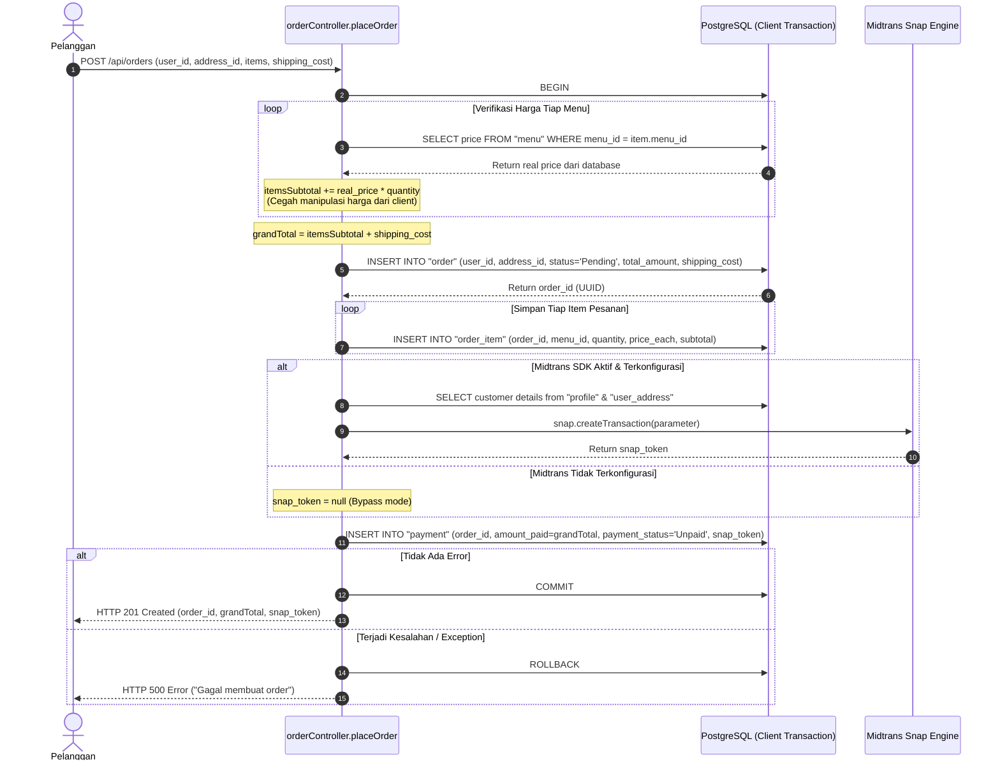
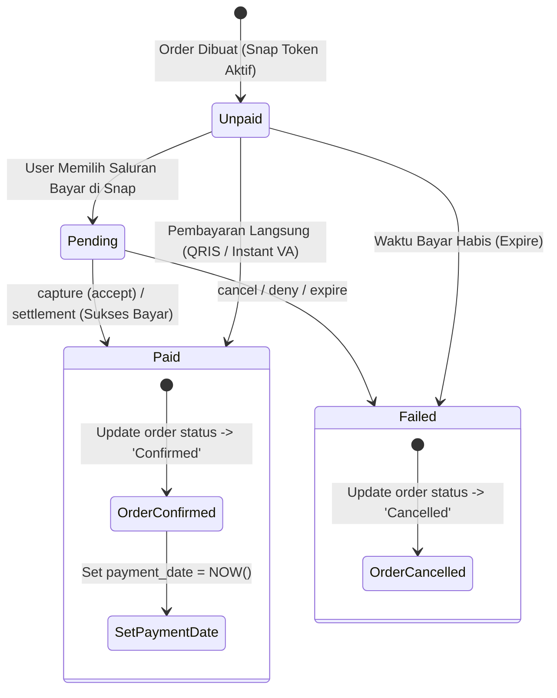

# 🧠 Logika Bisnis & Alur Transaksi Backend (Backend Business Logic)

Dokumen ini menjelaskan algoritma inti, logika transaksi ACID, *state machine* pembayaran Midtrans, dan formula kalkulasi ongkos kirim pada aplikasi **Dapur Nekti (MJ Kitchen)**.

---

## 1. Transaksi ACID Pembuatan Pesanan (`placeOrder`)

Pembuatan pesanan melibatkan banyak tabel (`order`, `order_item`, `payment`) dan layanan pihak ketiga (Midtrans). Untuk menjaga konsistensi data dan mencegah kehilangan data ketika terjadi kegagalan jaringan, logika ini dibungkus dalam **PostgreSQL Transaction Block (BEGIN - COMMIT - ROLLBACK)** pada [`orderController.js`](file:///d:/mj-kitchen/mj-backend/controllers/orderController.js).

### Diagram Alur Transaksi Pemesanan



### Pencegahan Manipulasi Harga (Price Anti-Tampering)
Aplikasi tidak pernah mempercayai nilai harga yang dikirim dari browser/frontend. Controller selalu melakukan query ulang ke tabel `menu` untuk mengambil harga resmi per porsi:
```javascript
let itemsSubtotal = 0;
for (const item of items) {
  const { rows } = await client.query('SELECT price FROM "menu" WHERE menu_id=$1', [item.menu_id]);
  if (!rows[0]) throw new Error('Menu tidak ditemukan');
  itemsSubtotal += Number(rows[0].price) * Number(item.quantity);
}
const grandTotal = itemsSubtotal + Number(shipping_cost || 0);
```

---

## 2. State Machine & Webhook Pembayaran Midtrans

Sinkronisasi status pembayaran diproses melalui webhook asinkron pada fungsi `processPayment`.

### Matriks Transisi Status Pembayaran



### Pemetaan Event Notifikasi Midtrans:
| Transaksi Midtrans (`transaction_status`) | Fraud Status (`fraud_status`) | Status Pembayaran (`payment_status`) | Status Pesanan (`order.status`) | Aksi Database Tambahan |
|---|---|---|---|---|
| `capture` | `accept` | **`Paid`** | **`Confirmed`** | `payment_date = NOW()` |
| `settlement` | *Any* | **`Paid`** | **`Confirmed`** | `payment_date = NOW()` |
| `pending` | *Any* | **`Pending`** | **`Pending`** | Menunggu pelunasan |
| `deny` | *Any* | **`Failed`** | **`Cancelled`** | Transaksi ditolak |
| `cancel` | *Any* | **`Failed`** | **`Cancelled`** | Transaksi dibatalkan |
| `expire` | *Any* | **`Failed`** | **`Cancelled`** | Batas bayar terlampaui |

### Validasi Keaslian Notifikasi (Signature Check)
Backend memanfaatkan method bawaan `coreApi.transaction.notification(notification)` yang menghitung SHA-512 dari gabungan `order_id + status_code + gross_amount + server_key` untuk memastikan notifikasi benar-benar berasal dari server Midtrans asli.

### Aturan Transisi Status Pengiriman & Terminal State Protection
Setelah pembayaran terkonfirmasi, pesanan berpindah ke fase operasional dapur dan logistik:
$$\text{Pending} \xrightarrow{\text{Bayar}} \text{Confirmed} \xrightarrow{\text{Dapur}} \text{Processing} \xrightarrow{\text{Kurir}} \text{Out for Delivery} \xrightarrow{\text{Diterima}} \text{Delivered}$$

- **Terminal States**: Status `Delivered` dan `Cancelled` bersifat mutlak (*immutable terminal states*). Sistem melarang perubahan status mundur (*regression*) dari status `Delivered` kembali ke `Processing` atau `Out for Delivery`, serta melarang reaktivasi pesanan yang telah dibatalkan (`Cancelled`).
- **Validasi Transisi**: Fungsi `updateOrderStatus` pada `orderController.js` secara ketat memverifikasi status asal pesanan sebelum mengizinkan pembaruan status ke database.
- Laporan pengujian lengkap transisi ini terdokumentasi di [testing-evaluation.md](file:///d:/mj-kitchen/mj-docs/testing/testing-evaluation.md#3-pengujian-batas-transisi-status-pengiriman-delivery-status-transitions).

---

## 3. Algoritma Perhitungan Jarak & Tarif Pengiriman

Sistem pengiriman Dapur Nekti mengandalkan koordinat rute jalan raya dari **Distance Matrix AI API** yang diimplementasikan pada [`shippingController.js`](file:///d:/mj-kitchen/mj-backend/controllers/shippingController.js).

### Parameter & Konstanta Bisnis:
- **Alamat Asal Dapur (Origin)**:
  `Setiabudi Regency no.G 110, Cihideung, Kec. Parongpong, Kabupaten Bandung Barat, Jawa Barat 40559`
- **Tarif Per Kilometer (`PRICE_PER_KM`)**: `Rp 3.000 / km`
- **Tarif Minimum Pengiriman (`MIN_SHIPPING_COST`)**: `Rp 10.000`
- **Batas Maksimal Radius Pengiriman (`MAX_DELIVERY_RADIUS_KM`)**: `50.0 km`
- **Ambang Batas Gratis Ongkir (`FREE_SHIPPING_THRESHOLD`)**: `Rp 500.000`

### Aturan Batas Radius (Boundary Value Policy):
1. **Dalam Radius Izin ($\le 50.0\text{ km}$)**: Pesanan diterima dan biaya kirim dihitung proporsional per kilometer dengan jaminan batas bawah tarif minimum Rp 10.000.
2. **Di Luar Radius Izin ($> 50.0\text{ km}$)**: Sistem mengembalikan HTTP 400 Bad Request dengan pesan peringatan ramah bahwa alamat tujuan berada di luar jangkauan operasional pengiriman makanan siap saji demi menjaga kesegaran hidangan.
3. Detail pengujian batas empiris ($R - \epsilon$, $R$, $R + \epsilon$) tercantum di [testing-evaluation.md](file:///d:/mj-kitchen/mj-docs/testing/testing-evaluation.md#4-pengujian-batas-radius-pengiriman-delivery-radius-limit).

### Formula Matematis:
$$\text{Jarak (KM)} = \frac{\text{Distance Value (meter)}}{1000}$$

$$\text{Ongkir Awal} = \left\lceil \text{Jarak (KM)} \times \text{Tarif Per KM} \right\rceil$$

$$\text{Ongkir Final} = \max(\text{Ongkir Awal}, \text{Tarif Minimum})$$

Jika total pesanan pelanggan melebihi $\text{Rp 500.000}$, kalkulator frontend dan sistem pendukung menerapkan potongan gratis ongkir.

### Penanganan Error API Eksternal:
- `REQUEST_DENIED`: Validasi akses kunci API Distance Matrix.
- `INVALID_REQUEST`: Pesan ramah kepada pelanggan agar melengkapi penulisan alamat.
- `OVER_QUERY_LIMIT`: Notifikasi kuota API tercapai dengan graceful fallback ke tarif flat (*Shipping Tiers*).

---

## 4. Sinkronisasi Profil Pengguna & Fallback Akun

Sistem mengintegrasikan Supabase Auth (penyimpan kredensial) dengan tabel lokal `profile` di PostgreSQL:

1. Setiap kali pengguna melakukan request dengan JWT, middleware `auth.js` mengecek keberadaan ID pengguna di tabel `profile`.
2. Jika pengguna baru pertama kali login melalui Google OAuth dan trigger basis data Supabase belum sempat membuat record profil, middleware mengeksekusi logika *self-healing*:
   ```javascript
   INSERT INTO profile (id, name, role, phone_number)
   VALUES ($1, $2, 'customer', $3)
   ```
   Nama diambil dari metadata user OAuth atau nama sebelum karakter `@` pada email.
3. Hak istimewa Admin dikunci berdasarkan nilai string literal `'admin'` pada kolom `profile.role`.
