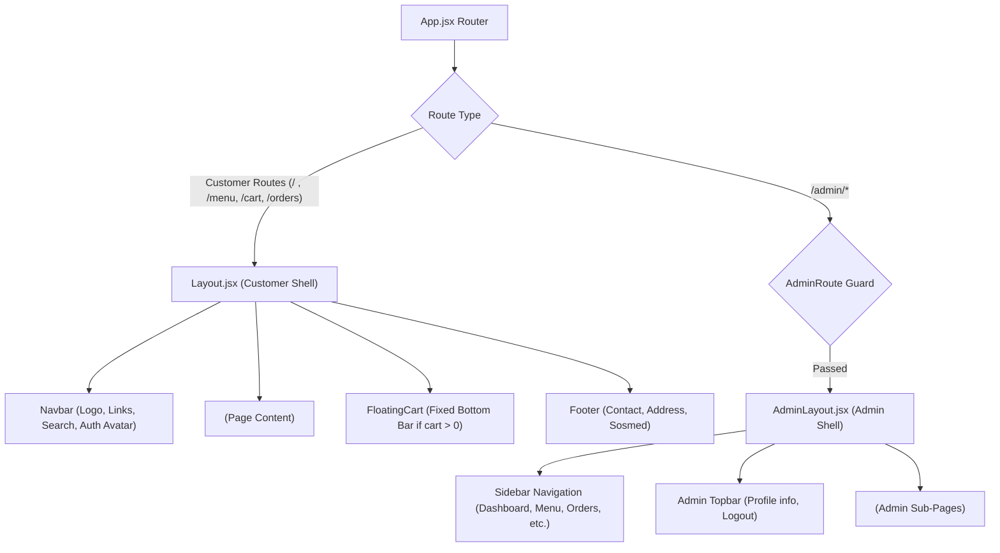

# 🎨 Desain Antarmuka & Arsitektur Frontend (Frontend Architecture & Design)

Dokumen ini menguraikan arsitektur rekayasa frontend pada repositori **`mj-frontend`**, panduan sistem desain antarmuka (*Design System & Brand Identity*), sistem layout, serta tata kelola routing dan Route Guards.

---

## 1. Arsitektur Frontend

Aplikasi frontend dibangun menggunakan **React 19** dengan bundler kilat **Vite 7** dan utilitas CSS berbasis **Tailwind CSS v3**.

### Struktur Pohon Modul Frontend
```
mj-frontend/
├── public/                    # Aset statis & favicon
├── src/
│   ├── assets/                # Gambar, logo SVG, dan ilustrasi lokal
│   ├── components/            # Komponen antarmuka yang dapat digunakan kembali
│   │   ├── AddOnModal.jsx     # Dialog kustomisasi catatan & add-on menu
│   │   ├── AddressManager.jsx # Manajemen buku alamat pelanggan
│   │   ├── AdminLayout.jsx    # Shell dashboard administrator dengan sidebar
│   │   ├── FloatingCart.jsx   # Tombol mengambang ringkasan keranjang
│   │   ├── Footer.jsx         # Footer aplikasi publik
│   │   ├── Layout.jsx         # Shell aplikasi publik (Navbar + Cart + Footer)
│   │   ├── MenuItem.jsx       # Card display hidangan menu
│   │   ├── Navbar.jsx         # Navigasi utama, status login, & menu drawer
│   │   ├── ProfileDetails.jsx # Form identitas pengguna
│   │   ├── ShippingCalculator.jsx # Komponen kalkulasi ongkir & alamat pop-up
│   │   └── WhatsAppButton.jsx # Generator tautan pesan order cepat via WhatsApp
│   ├── pages/                 # Halaman utama aplikasi
│   │   ├── admin/             # Modul halaman khusus Administrator
│   │   │   ├── AdminAddonsPage.jsx
│   │   │   ├── AdminAddressPage.jsx
│   │   │   ├── AdminCategoryPage.jsx
│   │   │   ├── AdminDashboard.jsx
│   │   │   ├── AdminGalleryPage.jsx
│   │   │   ├── AdminMenuPage.jsx
│   │   │   ├── AdminOrdersPage.jsx
│   │   │   ├── AdminProfilePage.jsx
│   │   │   └── AdminReportPage.jsx
│   │   ├── CartPage.jsx       # Checkout & integrasi Midtrans Snap
│   │   ├── HomePage.jsx       # Landing page Dapur Nekti
│   │   ├── LoginPage.jsx      # Form login email & tombol Google OAuth
│   │   ├── MenuPage.jsx       # Katalog hidangan lengkap & filter
│   │   ├── OrderTrackingPage.jsx # Riwayat dan pelacakan pesanan
│   │   ├── ProfilePage.jsx    # Pengaturan akun & alamat
│   │   ├── ReceiptPage.jsx    # Struk digital pesanan
│   │   └── RegisterPage.jsx   # Registrasi pengguna baru
│   ├── services/
│   │   ├── api.js             # Klien Axios dengan interceptor token JWT
│   │   └── supabase.js        # Klien Supabase SDK untuk Auth & Storage
│   ├── store/
│   │   ├── authStore.js       # Store Zustand untuk state otentikasi
│   │   └── cartStore.js       # Store Zustand keranjang belanja (persist)
│   ├── utils/
│   │   ├── shipping.js        # Helper tier ongkir & kuantitas
│   │   └── swal.js            # Helper notifikasi SweetAlert2
│   ├── App.jsx                # Router & Route Guards
│   ├── index.css              # Directive Tailwind CSS
│   └── main.jsx               # React DOM render entry point
├── tailwind.config.js         # Konfigurasi tema Tailwind
├── vercel.json                # Pengaturan rewrite SPA hosting Vercel
└── vite.config.js             # Konfigurasi plugin React & build Vite
```

---

## 2. Sistem Desain & Identitas Brand (Design System)

Brand **Dapur Nekti** merepresentasikan masakan rumahan lezat, higienis, segar, dan handal untuk acara mendesak (*dadakan*). Identitas visual didominasi warna teal/tosca modern yang menenangkan dan higienis.

### 2.1. Palet Warna Utama (Color Palette)

| Nama Warna | Kode Hex | Peran & Penggunaan |
|---|---|---|
| **Primary Teal** | `#03BEB0` | Warna identitas utama: Tombol aksi utama (CTA), badge aktif, highlight harga, ikon fokus |
| **Dark Teal** | `#065D5F` | Warna kontras & teks judul: Heading utama, header gradien, navbar gelap, ikon trust badge |
| **Soft Mint** | `#EBF2F2` | Latar belakang section sekunder, card trust badges, container input |
| **Light Teal Gradient**| `linear-gradient(135deg, #03BEB0 0%, #065D5F 100%)` | Banner header modal, struk digital, kartu promo |
| **Neutral White** | `#FFFFFF` | Latar belakang kartu konten, dropdown, latar form |
| **Slate Gray** | `#4B5563` - `#1F2937` | Teks paragraf, deskripsi hidangan, label input |
| **Accent Alert** | `#EF4444` / `#F59E0B` / `#10B981` | Notifikasi status: Batal/Hapus, Menunggu Pembayaran, Pesanan Berhasil |

### 2.2. Tipografi & Ikonografi
- **Font Utama**: Sans-Serif bersih (Inter / Roboto / System Sans) dengan bobot terstruktur (`font-extrabold` untuk headline hero, `font-bold` untuk nama menu dan harga, `font-medium` untuk label form).
- **Ikonografi Dual-Stack**:
  1. **Google Material Symbols Outlined**: Digunakan untuk ikon-ikon kuliner khusus (`restaurant_menu`, `tapas`, `rice_bowl`, `skillet`, `egg_alt`, `takeout_dining`).
  2. **Feather Icons (`react-icons/fi`)**: Digunakan untuk kontrol antarmuka umum (`FiSearch`, `FiTruck`, `FiClock`, `FiShield`, `FiArrowRight`, `FiShoppingBag`).

### 2.3. Mikro-Interaksi & Visual Motion
- **Elevasi Dinamis**: Tombol utama memiliki efek hover responsif (`hover:shadow-xl transform hover:-translate-y-0.5 transition-all`).
- **Modal Masuk**: Modal kustomisasi add-on dan form alamat menggunakan animasi *smooth scale* (`animate-in fade-in zoom-in duration-200`).
- **Pola Geometris Transparan**: Header dan section hero menggunakan ornamen latar SVG dengan opasitas 10% untuk menambah kedalaman visual tanpa mengganggu keterbacaan teks.

---

## 3. Sistem Layout & Navigasi

Aplikasi menerapkan pola **Two-Shell Layout**:



### 3.1. Customer Shell (`components/Layout.jsx`)
- Menyediakan navigasi atas yang konsisten dengan indikator jumlah item keranjang belanja.
- Menyediakan komponen `FloatingCart` di bagian bawah layar yang otomatis muncul ketika ada item di keranjang belanja (dan otomatis disembunyikan saat pengguna berada di halaman `/cart` atau `/orders`).

### 3.2. Admin Shell (`components/AdminLayout.jsx`)
- Tampilan dua kolom khusus desktop dengan sidebar navigasi vertikal:
  - **Dashboard**: Ringkasan omzet dan jumlah transaksi.
  - **Kelola Menu**: CRUD hidangan dan ketersediaan stok.
  - **Kategori**: Pengelompokan jenis makanan.
  - **Pesanan**: Pemrosesan status operasional dapur dan kurir.
  - **Pengguna & Alamat**: Verifikasi profil pelanggan.
  - **Laporan Penjualan**: Laporan transaksi dengan ekspor Excel.
  - **Add-ons**: Pengaturan item ekstra makanan.

---

## 4. Sistem Keamanan Rute (Route Guards)

Didefinisikan pada [`App.jsx`](file:///d:/mj-kitchen/mj-frontend/src/App.jsx):

### 4.1. `PrivateRoute`
Melindungi halaman yang mewajibkan otentikasi (seperti `/orders`, `/orders/:orderId/receipt`, dan `/profile`).
```jsx
const PrivateRoute = ({ children }) => {
  const token = useAuthStore((s) => s.token);
  if (!token) return <Navigate to="/login" replace />;
  return children;
};
```

### 4.2. `AdminRoute`
Melindungi seluruh sub-rute `/admin/*`:
1. Jika status `loading` masih bernilai `true` (saat authStore sedang memverifikasi token ke backend), merender layar tunggu (*spinner*).
2. Jika tidak ada `token`, mengarahkan ke `/login`.
3. Jika profil sudah dimuat namun `profile?.role !== 'admin'`, melempar pengguna kembali ke halaman utama `/`.
4. Hanya merender `AdminLayout` jika role terbukti `'admin'`.
