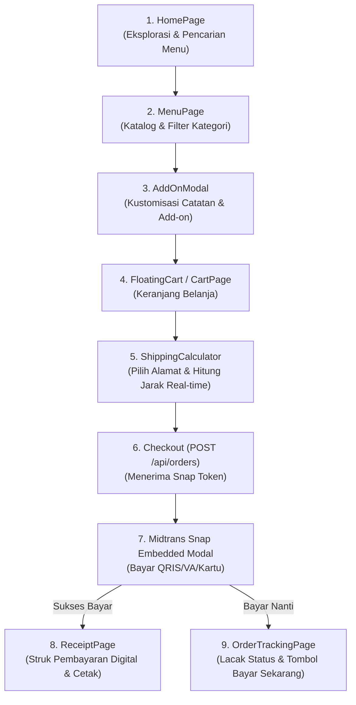

# 🖥️ Panduan Halaman & Komponen Antarmuka (Pages & Components)

Dokumen ini menyajikan rincian fungsional, alur pengguna (*user flows*), serta spesifikasi komponen untuk seluruh halaman pelanggan dan panel administrator pada aplikasi **Dapur Nekti (MJ Kitchen)**.

---

## 1. Alur Pengguna Pelanggan (Customer Experience Flow)



---

## 2. Rincian Halaman Pelanggan (Customer Pages)

### 2.1. Beranda (`HomePage.jsx`)
- **Headline Utama**: *"Pesan Dadakan? Tanpa Deg-degan!"* dengan sub-judul kesiapan pengiriman ribuan porsi 24 jam.
- **Pencarian Cepat**: Kolom input pencarian menu dengan tombol filter yang langsung mengarahkan pengguna ke `/menu`.
- **Trust Badges & Social Proof**:
  - Menampilkan lencana jaminan mutu: *Mutu Terjamin*, *Laik Hygiene*, dan *Bahan Segar*.
  - Menampilkan statistik pencapaian operasional: `1K++` pesanan, `500++` pelanggan, `50+` variasi menu, dan `5th+` tahun pengalaman melayani katering di Bandung Raya.
- **Preview Kategori**: Menampilkan 6 kategori hidangan teratas yang dimuat dinamis dari API.

### 2.2. Katalog Menu (`MenuPage.jsx`)
- **Kategori Tab Horizontal**: Tab kategori dengan ikon Material Symbols dinamis (misal: nasi = `rice_bowl`, ayam = `egg_alt`, sayur = `eco`, tumpeng/paket = `takeout_dining`).
- **Pencarian Real-Time**: Input teks untuk memfilter hidangan berdasarkan nama menu atau deskripsi bumbu.
- **Grid Menu**: Card menu responsif yang menampilkan foto utama, nama makanan, deskripsi porsi, harga dalam format Rupiah, dan status ketersediaan.
- **Aksi Cepat**: Tombol *Order* langsung membuka modal kustomisasi.

### 2.3. Modal Kustomisasi Menu (`components/AddOnModal.jsx`)
- **Kuantitas Porsi**: Tombol `+` dan `-` untuk menentukan jumlah pesanan.
- **Catatan Khusus**: Kolom catatan kustomisasi katering (contoh: *"Sambal dipisah"*, *"Ayam bagian paha"*).
- **Pilihan Add-on**: Daftar pelengkap tambahan (ekstra sambal, nasi putih, kerupuk udang, telur dadar) dengan harga dinamis yang otomatis menambahkan total belanjaan item.

### 2.4. Halaman Keranjang & Pembayaran (`CartPage.jsx`)
- **Daftar Belanja**: Menampilkan rincian menu beserta catatan dan add-on yang dipilih. Pengguna dapat mengubah jumlah porsi atau menghapus item.
- **Kalkulator Ongkos Kirim (`components/ShippingCalculator.jsx`)**:
  - Memilih dari buku alamat pelanggan yang tersimpan.
  - Opsi pop-up tambah alamat baru (`AddAddressModal`) langsung di tempat tanpa meninggalkan keranjang.
  - Memanggil endpoint `/api/shipping/calculate` untuk menampilkan jarak riil (km), estimasi durasi antar (menit), dan biaya kirim akurat.
- **Checkout & Midtrans Snap Embed**:
  - Tombol *Lanjutkan ke Pembayaran* memanggil `POST /api/orders` dan menerima `snap_token`.
  - Membuka modal pembayaran Midtrans Snap secara embedded (`window.snap.embed`) di dalam kontainer `#snap-container`.
  - Saat pembayaran tuntas (`onSuccess`), memicu update otomatis ke `/api/orders/:id/payment` dan mengarahkan ke halaman struk.
- **Fallback WhatsApp**: Tombol alternatif untuk menghasilkan pesan pesanan instan terformat ke nomor WhatsApp admin katering.

### 2.5. Pelacakan Pesanan (`OrderTrackingPage.jsx`)
- **Kartu Pesanan Riil**: Menampilkan daftar seluruh pesanan yang pernah dibuat oleh akun pelanggan.
- **Indikator Visual Status Pesanan**:
  - `Pending` (Kuning, ikon `schedule`): Menunggu konfirmasi / pembayaran.
  - `Confirmed` (Biru, ikon `task_alt`): Pesanan telah diterima dan diverifikasi dapur.
  - `Processing` (Oranye, ikon `skillet`): Hidangan sedang dimasak di dapur.
  - `Out for Delivery` (Ungu, ikon `local_shipping`): Makanan sedang diantar oleh kurir.
  - `Delivered` (Hijau Teal, ikon `check_circle`): Makanan telah sampai di tujuan.
  - `Cancelled` (Merah, ikon `cancel`): Pesanan dibatalkan.
- **Tombol Bayar Sekarang**: Untuk pesanan yang berstatus belum bayar (`Unpaid`), pengguna dapat mengklik tombol ini untuk memunculkan kembali modal pembayaran Midtrans Snap menggunakan token yang sudah tersimpan.
- **Akses Struk**: Tautan menuju struk digital `/orders/:orderId/receipt`.

### 2.6. Struk Digital Pembayaran (`ReceiptPage.jsx`)
- **Header Status**: Banner hijau dengan gradien teal untuk order lunas (*Paid*) atau oranye untuk pending.
- **Rincian Faktur**: Nomor Order ID, tanggal & jam transaksi (bahasa Indonesia via `date-fns/locale/id`), nama pelanggan, nomor telepon, alamat tujuan lengkap, rincian hidangan, biaya pengiriman, dan total akhir.
- **Fitur Cetak**: Tombol *Cetak Struk* yang memicu `window.print()` dengan optimasi CSS print (`print:hidden` pada elemen navigasi/tombol aksi).

---

## 3. Rincian Panel Administrator (Admin Backoffice)

Rute admin berada di bawah prefix `/admin/*` dan dilindungi oleh `AdminRoute`.

```
/admin
├── / (Dashboard KPI)
├── /menu (Manajemen Menu)
├── /categories (Manajemen Kategori)
├── /menu/:menuId/gallery (Galeri Foto Menu)
├── /orders (Pemrosesan Pesanan)
├── /profiles (Manajemen Akun Pengguna)
├── /profiles/:userId/addresses (Manajemen Alamat Pengguna)
├── /reports (Laporan Penjualan & Ekspor Excel)
└── /addons (Manajemen Add-ons)
```

### 3.1. Dashboard Utama (`AdminDashboard.jsx`)
- **Kartu Statistik Utama**: Total Pendapatan kotor, Total Pesanan, Total Pelanggan unik, dan Jumlah Pesanan Pending yang membutuhkan tindakan segera.
- **Performa Hari Ini & Bulan Ini**: Perbandingan omzet dan kuantitas order terkini.
- **Distribusi Status**: Pengelompokan pesanan berdasarkan status operasional.
- **Tabel 5 Pesanan Terkini**: Daftar pesanan paling baru dengan akses cepat ke rincian.
- **Top 5 Menu Terlaris**: Peringkat hidangan paling diminati berdasarkan volume porsi terjual.

### 3.2. Manajemen Pesanan (`AdminOrdersPage.jsx`)
- **Pencarian & Filter**: Pencarian berdasarkan ID order atau nama pembeli, filter dropdown status order, dan filter status pembayaran.
- **Laci Rincian Pesanan (Detail Drawer)**: Melihat menu yang dipesan, alamat antar, catatan pemesan, dan riwayat pembayaran.
- **Kontrol Status**: Tombol pembaruan status bertahap dengan dialog konfirmasi SweetAlert2 (`confirmAction`) untuk memindahkan pesanan dari *Pending* -> *Confirmed* -> *Processing* -> *Out for Delivery* -> *Delivered*.

### 3.3. Manajemen Katalog Menu & Kategori
- **`AdminMenuPage.jsx`**: Form pembuatan dan pengeditan menu lengkap dengan nama, kategori, harga, deskripsi, dan toggle ketersediaan (*available/unavailable*).
- **Unggah Foto Produk**: Terintegrasi langsung dengan helper `uploadImage()` ke Supabase Storage bucket `menu-images`.
- **`AdminGalleryPage.jsx`**: Mengelola multi-foto untuk satu menu dan menambahkan keterangan caption.
- **`AdminCategoryPage.jsx`**: Tambah, ubah, dan hapus grup klasifikasi hidangan makanan.

### 3.4. Laporan Penjualan & Ekspor Excel Multi-Sheet (`AdminReportPage.jsx`)
- **Filter Rentang Waktu**: Pemilihan tanggal awal (`startDate`) dan tanggal akhir (`endDate`) dengan default bulan berjalan.
- **Ringkasan Finansial**: Menghitung omzet bersih, jumlah pesanan sukses, dan rasio penyelesaian order.
- **Ekspor Excel Canggih (SheetJS / `xlsx`)**: Menghasilkan file workbook `.xlsx` komprehensif berstandar akuntansi dengan struktur:
  1. **Sheet 1 (Cover & Ringkasan Eksekutif)**: Informasi brand, periode laporan, tanggal cetak, dan tabel indikator performa utama.
  2. **Sheet 2 (Detail Transaksi)**: Daftar seluruh faktur transaksi (Order ID, Tanggal, Pelanggan, Status, Total Amount, Status Bayar).
  3. **Sheet 3 (Performa Produk Terlaris)**: Peringkat menu terlaris beserta total porsi terjual dan kontribusi omzet.

### 3.5. Manajemen Pengguna & Hak Akses
- **`AdminProfilePage.jsx`**: Melihat daftar seluruh akun yang terdaftar. Administrator dapat mengubah role akun pengguna dari `customer` menjadi `admin` atau sebaliknya.
- **`AdminAddressPage.jsx`**: Memeriksa dan mengelola alamat pengiriman milik pelanggan tertentu untuk membantu pesanan manual via telepon/WhatsApp.
