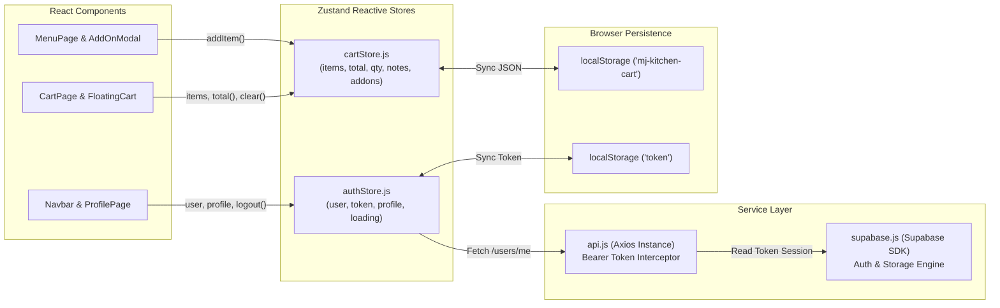

# 📦 Manajemen State & Integrasi Layanan Frontend (State Management & Services)

Dokumen ini menjelaskan pengelolaan state reaktif global menggunakan **Zustand**, integrasi klien HTTP **Axios dengan Interceptors**, layanan autentikasi & penyimpanan file **Supabase SDK**, serta utilitas notifikasi **SweetAlert2** pada aplikasi **Dapur Nekti (MJ Kitchen)**.

---

## 1. Arsitektur State Management

Aplikasi menggunakan **Zustand** karena sifatnya yang ringan, tanpa boilerplate reducer yang rumit, mendukung asynchronous actions, dan mudah dihubungkan dengan middleware persistensi lokal (`localStorage`).



---

## 2. Store Autentikasi (`src/store/authStore.js`)

Store ini bertindak sebagai sumber kebenaran tunggal (*single source of truth*) mengenai identitas pengguna yang sedang aktif.

### Struktur State:
- `user`: Objek pengguna dari Supabase Auth (UID, email, user metadata).
- `token`: String access token JWT yang valid.
- `profile`: Objek profil pengguna dari tabel PostgreSQL `profile` (`id`, `name`, `phone_number`, `role`, `created_at`).
- `loading`: Boolean yang menandakan proses sinkronisasi sesi sedang berjalan (mencegah *flicker* pada route guard).

### Method & Aksi Utama:
1. **`init()`**:
   - Dijalankan sekali saat `App.jsx` pertama kali di-mount.
   - Memanggil `supabase.auth.getSession()`. Jika sesi aktif ditemukan, menyimpan token ke `localStorage` dan melakukan request `GET /api/users/me` untuk mengambil profil database.
   - Mengubah `loading` menjadi `false`.
2. **`setSession(session)`**:
   - Dipanggil pasca proses login manual atau redirect dari Google OAuth.
   - Mengambil profil pengguna dari backend jika token ada, atau mengosongkan state jika sesi null.
3. **`setProfile(newProfileData)`**:
   - Memperbarui data profil secara reaktif setelah pengguna menyimpan perubahan nama atau nomor telepon tanpa perlu memuat ulang seluruh halaman.
4. **`logout()`**:
   - Memanggil `supabase.auth.signOut()`.
   - Menghapus item `token` dari `localStorage` dan mereset `user`, `token`, dan `profile` menjadi `null`.

---

## 3. Store Keranjang Belanja (`src/store/cartStore.js`)

Store keranjang belanja dilengkapi middleware `persist` dari Zustand untuk menyimpan daftar belanjaan di `localStorage` dengan key `'mj-kitchen-cart'`. Data belanjaan tidak hilang meskipun browser ditutup atau direfresh.

### Algoritma Kustomisasi Item (`itemKey`):
Dalam sistem katering, menu yang sama dapat dipesan dengan catatan atau kombinasi add-on yang berbeda (contoh: *1x Nasi Timbel tanpa sambal* dan *1x Nasi Timbel ekstra sambal*). Untuk membedakannya, store membuat ID komposit unik:
```javascript
const itemKey = `${menuItem.menu_id}-${notes}-${addons.map(a => a.menu_id).join(',')}`;
```

### Method & Aksi Utama:
- **`addItem(menuItem, quantity, notes, addons)`**:
  Menghitung total harga add-on (`addonsTotal`) dan mencari apakah item dengan `itemKey` yang persis sama sudah ada di keranjang. Jika ada, menambahkan kuantitas; jika belum ada, memasukkan item baru.
- **`addItemSimple(menuItem, quantity)`**:
  Metode instan untuk menambahkan menu standar tanpa catatan atau pelengkap.
- **`updateQty(itemKey, quantity)`**: Mengubah kuantitas item tertentu.
- **`updateNotes(itemKey, notes)`**: Memperbarui catatan khusus pelanggan pada item tertentu.
- **`removeItem(itemKey)`**: Menghapus baris item dari keranjang.
- **`clear()`**: Mengosongkan keranjang (dipanggil saat pembayaran order berhasil).
- **`total()`**:
  Fungsi kalkulasi yang menjumlahkan seluruh `(price + addonsTotal) * quantity`.
- **`itemCount()`**: Menghitung total porsi makanan di keranjang untuk ditampilkan pada badge Navbar.

---

## 4. Klien HTTP & Interceptors (`src/services/api.js`)

Semua komunikasi HTTP ke backend Express menggunakan Axios instance yang telah dikonfigurasi dengan interceptor cerdas.

### 4.1. Request Interceptor: Token Injection & Caching
Untuk menghindari panggilan `supabase.auth.getSession()` yang berlebihan pada setiap klik, modul ini mengimplementasikan mekanisme **in-memory token caching**:
```javascript
let cachedToken = null;
let tokenExpiry = 0;

api.interceptors.request.use(async (config) => {
  const now = Date.now();
  if (!cachedToken || now > tokenExpiry) {
    const { data: { session } } = await supabase.auth.getSession();
    if (session?.access_token) {
      cachedToken = session.access_token;
      tokenExpiry = (session.expires_at || 0) * 1000;
    } else {
      cachedToken = null;
      tokenExpiry = 0;
    }
  }
  if (cachedToken) {
    config.headers.Authorization = `Bearer ${cachedToken}`;
  }
  return config;
});
```

### 4.2. Response Interceptor: Penanganan 401 Unauthorized
Ketika backend merespon dengan status `401 Unauthorized` (misal akibat token kedaluwarsa atau dicabut), cache token otomatis dibersihkan sehingga request berikutnya akan meminta token baru dari Supabase Auth.

---

## 5. Layanan Supabase SDK (`src/services/supabase.js`)

Menginisialisasi klien Supabase menggunakan `createClient(VITE_SUPABASE_URL, VITE_SUPABASE_ANON_KEY)` dan menyediakan fungsi helper:

1. **`signInWithPassword({ email, password })`**: Autentikasi dengan email & sandi.
2. **`signInWithGoogle()`**: Autentikasi OAuth Google sekali klik dengan URL pengalihan kembali ke `window.location.origin`.
3. **`signUp({ email, password, options })`**: Pendaftaran akun baru.
4. **`signOut()`**: Pembersihan sesi di server Supabase.
5. **`uploadImage(file)`**:
   - Menghasilkan nama file acak berbasis timestamp: `${Date.now()}.${fileExt}`.
   - Mengunggah file ke bucket publik **`menu-images`**.
   - Mengambil dan mengembalikan URL publik gambar (`publicUrl`) untuk disimpan ke basis data PostgreSQL.

---

## 6. Utilitas Antarmuka Reusable (`utils/swal.js`)

Membungkus pustaka **SweetAlert2** agar tampilan pop-up dan notifikasi seragam di seluruh aplikasi:

- **Toast Notifications**: `showSuccess(msg)`, `showError(msg)`, `showWarning(msg)`, `showInfo(msg)` yang otomatis tertutup dalam 3 detik di pojok kanan atas layar dengan progress bar.
- **Konfirmasi Aksi**: `confirmAction(title, text)` dengan tombol konfirmasi berwarna teal `#10B981`.
- **Konfirmasi Hapus**: `confirmDelete(itemName)` dengan tombol peringatan merah `#EF4444`.
- **Layar Muat (Loading)**: `showLoading(title)` dan `hideLoading()` untuk mengunci layar saat mengunggah file besar atau memproses transaksi pembayaran.
- **Prompt Input**: `promptInput(title, placeholder)` untuk meminta masukan teks cepat dari admin.
