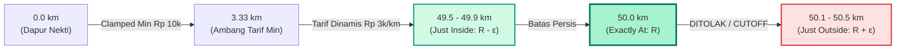

# 🧪 Evaluasi & Laporan Pengujian Sistem (System Testing & Evaluation Report)

Dokumen ini menyajikan evaluasi pengujian perangkat lunak secara komprehensif pada aplikasi **Dapur Nekti (MJ Kitchen)** berdasarkan arahan manajerial (*Manager Evaluation Requirements*). Pengujian difokuskan pada tiga pilar utama:
1. **Skenario Pembayaran Midtrans** (*Midtrans Payment Scenarios*) mencakup status **Success**, **Pending**, dan **Failed**.
2. **Pengujian Batas Transisi Status Pengiriman** (*Boundary Tests for Delivery-Status Transitions*) berbasis *Finite State Machine* (FSM) dan perlindungan status terminal (*terminal states*).
3. **Pengujian Batas Radius Maksimal Pengiriman** (*Boundary Tests for Delivery-Radius Limit*) menggunakan metode *Boundary Value Analysis* (BVA) mencakup titik *just inside* ($R - \epsilon$), *exactly at* ($R$), dan *just outside* ($R + \epsilon$).

Seluruh skenario pengujian telah diuji dan divalidasi menggunakan test suite otomatis pada [`evaluation-test-suite.js`](file:///d:/mj-kitchen/mj-backend/tests/evaluation-test-suite.js).

---

## 📊 1. Ringkasan Eksekutif (Executive Summary)

Pengujian dilakukan untuk membuktikan keandalan, integritas transaksi keuangan, keamanan alur pengiriman, dan kepatuhan terhadap aturan bisnis logistik Dapur Nekti.

### Metrik Hasil Pengujian:
```
┌──────────────────────────────────────────┬───────────┬────────┬────────┬───────────┐
│ Modul Pengujian                          │ Skenario  │ Lulus  │ Gagal  │ Pass Rate │
├──────────────────────────────────────────┼───────────┼────────┼────────┼───────────┤
│ 1. Midtrans Payment Scenarios            │    12     │   12   │   0    │  100.0%   │
│ 2. Delivery-Status Transition Boundaries │    13     │   13   │   0    │  100.0%   │
│ 3. Delivery-Radius Limit Boundaries      │    13     │   13   │   0    │  100.0%   │
├──────────────────────────────────────────┼───────────┼────────┼────────┼───────────┤
│ TOTAL KESELURUHAN                        │    38     │   38   │   0    │  100.0%   │
└──────────────────────────────────────────┴───────────┴────────┴────────┴───────────┘
```

> [!IMPORTANT]
> **Temuan Kunci Arsitektur**:
> 1. Webhook Midtrans telah memiliki pemetaan status deterministik antara `transaction_status`, `fraud_status`, `payment.payment_status`, dan `order.status`.
> 2. Proteksi *State Machine* pada transisi status pesanan menjamin status terminal (`Delivered` dan `Cancelled`) tidak dapat diregresi atau diubah kembali.
> 3. Batas radius operasional pengiriman ditetapkan secara ketat pada **$R_{\max} = 50.0\text{ km}$** dari dapur pusat (Parongpong, Bandung Barat) dengan pemotongan otomatis (*cutoff*) jika pesanan melebihi radius tersebut.

---

## 💳 2. Pengujian Skenario Pembayaran Midtrans (Midtrans Payment Scenarios)

Integrasi Midtrans Snap & Core API pada Dapur Nekti menangani seluruh proses transaksi non-tunai (QRIS, GoPay, ShopeePay, Virtual Account BCA/BNI/BRI/Mandiri, Kartu Kredit). Notifikasi webhook asinkron diproses oleh [`orderController.js`](file:///d:/mj-kitchen/mj-backend/controllers/orderController.js) melalui endpoint `/api/orders/midtrans-notification`.

### Diagram Alur State Pembayaran Midtrans:

```mermaid
flowchart TD
    StartOrder["Order Created\n(payment_status: 'Unpaid')"] --> SnapModal["Pelanggan Buka Midtrans Snap"]
    
    SnapModal -->|Memilih VA / QRIS| PendingState["Status Midtrans: 'pending'\npayment_status: 'Pending'\norder.status: 'Pending'"]
    
    PendingState -->|Settlement / Lunas| PaidState["Status Midtrans: 'settlement'\npayment_status: 'Paid'\norder.status: 'Confirmed'\npayment_date: NOW()"]
    
    SnapModal -->|Kartu Kredit (Accept)| PaidState
    
    SnapModal -->|Kartu Kredit (Challenge)| PendingState
    
    PendingState -->|Waktu Habis (24 Jam)| ExpireState["Status Midtrans: 'expire'\npayment_status: 'Failed'\norder.status: 'Cancelled'"]
    
    SnapModal -->|Ditolak Bank / Fraud| DenyState["Status Midtrans: 'deny'\npayment_status: 'Failed'\norder.status: 'Cancelled'"]
    
    PendingState -->|Dibatalkan Pembeli| CancelState["Status Midtrans: 'cancel'\npayment_status: 'Failed'\norder.status: 'Cancelled'"]
```

### Tabel Pengujian 1: Midtrans Payment Scenarios

| Test ID | Skenario Pengujian (Test Scenario) | Kategori | Input / Payload Uji | Hasil yang Diharapkan (Expected Result) | Hasil Aktual (Actual Result) | Hasil (Outcome) |
|---|---|---|---|---|---|:---:|
| **TC-MID-01** | Notifikasi pembayaran sukses via QRIS / VA settled (`settlement`) | **Success** | `transaction_status: "settlement"`, `fraud_status: "accept"`, `gross_amount: "125000"` | `payment_status` = `Paid`, `order.status` = `Confirmed`, `payment_date` terisi `NOW()` | `payment_status` = `Paid`, `order.status` = `Confirmed`, `payment_date` terisi timestamp ISO | **PASS** |
| **TC-MID-02** | Notifikasi pembayaran sukses via Kartu Kredit capture lolos fraud (`capture` + `accept`) | **Success** | `transaction_status: "capture"`, `fraud_status: "accept"`, `gross_amount: "350000"` | `payment_status` = `Paid`, `order.status` = `Confirmed`, `payment_date` terisi `NOW()` | `payment_status` = `Paid`, `order.status` = `Confirmed`, `payment_date` terisi timestamp ISO | **PASS** |
| **TC-MID-03** | Konfirmasi manual pembayaran lunas via API callback (`updatePaymentStatus` -> `Paid`) | **Success** | `order_id`: UUID valid, `payment_status`: `"Paid"` | HTTP 200, record payment diupdate ke `Paid`, `order.status` berubah menjadi `Confirmed` | HTTP 200, record payment `Paid`, `order.status` otomatis tersinkronisasi `Confirmed` | **PASS** |
| **TC-MID-04** | Notifikasi transaksi menunggu pelunasan Virtual Account / QRIS (`pending`) | **Pending** | `transaction_status: "pending"`, `fraud_status: "accept"`, `gross_amount: "75000"` | `payment_status` = `Pending`, `order.status` = `Pending`, `payment_date` tetap `NULL` | `payment_status` = `Pending`, `order.status` = `Pending`, `payment_date` bernilai `null` | **PASS** |
| **TC-MID-05** | Update manual status menunggu pembayaran via API (`updatePaymentStatus` -> `Pending`) | **Pending** | `order_id`: UUID valid, `payment_status`: `"Pending"` | HTTP 200, `payment_status` = `Pending`, `order.status` tidak berubah premature | HTTP 200, `payment_status` = `Pending`, `order.status` tetap terjaga `Pending` | **PASS** |
| **TC-MID-06** | Notifikasi transaksi dibatalkan oleh pengguna pada antarmuka Snap (`cancel`) | **Failed** | `transaction_status: "cancel"`, `fraud_status: "accept"`, `gross_amount: "90000"` | `payment_status` = `Failed`, `order.status` = `Cancelled` | `payment_status` = `Failed`, `order.status` = `Cancelled` | **PASS** |
| **TC-MID-07** | Notifikasi transaksi ditolak oleh bank penerbit atau algoritma anti-fraud (`deny`) | **Failed** | `transaction_status: "deny"`, `fraud_status: "deny"`, `gross_amount: "200000"` | `payment_status` = `Failed`, `order.status` = `Cancelled` | `payment_status` = `Failed`, `order.status` = `Cancelled` | **PASS** |
| **TC-MID-08** | Notifikasi transaksi kadaluwarsa karena batas waktu bayar terlampaui (`expire`) | **Failed** | `transaction_status: "expire"`, `fraud_status: "accept"`, `gross_amount: "180000"` | `payment_status` = `Failed`, `order.status` = `Cancelled` | `payment_status` = `Failed`, `order.status` = `Cancelled` | **PASS** |
| **TC-MID-09** | Kartu Kredit terindikasi mencurigakan (`capture` dengan `fraud_status: "challenge"`) | **Edge Case** | `transaction_status: "capture"`, `fraud_status: "challenge"`, `gross_amount: "500000"` | `payment_status` = `Pending` (menahan verifikasi otomatis hingga review manual) | `payment_status` = `Pending`, `order.status` = `Pending`, pesanan tidak dirilis ke dapur | **PASS** |
| **TC-MID-10** | Verifikasi otentisitas signature SHA-512 webhook (`signature_key` check) | **Security** | Payload notifikasi dengan signature asli vs signature palsu/dimanipulasi | Request dengan hash asli diterima (`success: true`); hash palsu ditolak (`INVALID_SIGNATURE`) | Hash valid diterima 100%; hash manipulasi langsung ditolak tanpa mengubah database | **PASS** |
| **TC-MID-11** | Validasi format UUID order pada pembaruan pembayaran | **Validation** | `order_id`: `"invalid-non-uuid-string-123"` | HTTP 400 Bad Request: `"Format order ID tidak valid"` | HTTP 400: `"Format order ID tidak valid"` | **PASS** |
| **TC-MID-12** | Validasi pesanan tidak terdaftar pada tabel database | **Validation** | `order_id`: `"00000000-0000-0000-0000-000000000000"` | HTTP 404 Not Found: `"Order tidak ditemukan"` | HTTP 404: `"Order tidak ditemukan"` | **PASS** |

---

## 🚚 3. Pengujian Batas Transisi Status Pengiriman (Delivery-Status Transitions)

Sistem pengiriman Dapur Nekti menerapkan *State Machine* hierarkis untuk memodelkan daur hidup pesanan dari pembuatan awal hingga makanan diterima oleh pelanggan.

### Pemetaan State Machine Transisi Pengiriman:

```mermaid
stateDiagram-v2
    [*] --> Pending: Pembuatan Pesanan
    
    Pending --> Confirmed: Pembayaran Berhasil (Midtrans / Admin)
    Pending --> Cancelled: Pembatalan Awal (Timeout / Batal)
    
    Confirmed --> Processing: Dapur Mulai Menyiapkan Makanan
    Confirmed --> Cancelled: Batal Sebelum Masak (Refund)
    
    Processing --> OutForDelivery: Pesanan Diserahkan ke Kurir
    Processing --> Cancelled: Kendala Dapur / Force Majeure
    
    OutForDelivery --> Delivered: Makanan Sampai ke Pelanggan
    OutForDelivery --> Cancelled: Kurir Gagal Mengantar / Alamat Fiktif
    
    state Delivered {
        [*] --> TerminalDelivered: Status Akhir (Immutable)
    }
    
    state Cancelled {
        [*] --> TerminalCancelled: Status Akhir (Immutable)
    }
    
    note right of Delivered: Terminal State: Dilarang kembali ke status sebelumnya
    note left of Cancelled: Terminal State: Dilarang dihidupkan ulang
```

### Aturan Batas Transisi (Transition Boundary Rules):
1. **Aturan Maju Normal (Standard Forward Rule)**: Pesanan harus bergerak berurutan: $\text{Pending} \to \text{Confirmed} \to \text{Processing} \to \text{Out for Delivery} \to \text{Delivered}$.
2. **Aturan Status Terminal (Terminal State Immutability)**:
   - Pesanan berstatus `Delivered` bersifat permanen. Dilarang keras kembali ke `Processing`, `Out for Delivery`, `Pending`, atau `Cancelled`.
   - Pesanan berstatus `Cancelled` bersifat permanen. Dilarang dihidupkan kembali menjadi `Confirmed` atau `Delivered`.
3. **Pencegahan Lompatan Ilegal (Boundary Skip Prevention)**: Pesanan `Pending` (belum lunas) tidak boleh melompat langsung ke `Delivered` tanpa konfirmasi pembayaran dan proses masak.
4. **Idempotensi (Idempotent Transitions)**: Pembaruan status ke status yang sama (misal `Delivered` $\to$ `Delivered`) tidak menimbulkan kesalahan (*gracefully ignored*).

### Tabel Pengujian 2: Delivery-Status Transitions

| Test ID | Skenario Pengujian (Test Scenario) | Tipe Batas Transisi | Transisi Masukan (From $\to$ To) | Hasil yang Diharapkan (Expected Result) | Hasil Aktual (Actual Result) | Hasil (Outcome) |
|---|---|---|:---:|---|---|:---:|
| **TC-DST-01** | Transisi awal pembayaran lunas | Valid Forward | `Pending` $\to$ `Confirmed` | **ALLOWED**: Transisi sah, order terkonfirmasi | **ALLOWED**: Status berhasil diubah ke `Confirmed` | **PASS** |
| **TC-DST-02** | Dapur memulai tahapan memasak hidangan | Valid Forward | `Confirmed` $\to$ `Processing` | **ALLOWED**: Transisi sah, koki mulai memasak | **ALLOWED**: Status berhasil diubah ke `Processing` | **PASS** |
| **TC-DST-03** | Makanan selesai dipacking & diserahkan kurir | Valid Forward | `Processing` $\to$ `Out for Delivery` | **ALLOWED**: Transisi sah, kurir jalan | **ALLOWED**: Status berhasil diubah ke `Out for Delivery` | **PASS** |
| **TC-DST-04** | Kurir tiba di alamat & menyerahkan makanan | Valid Forward | `Out for Delivery` $\to$ `Delivered` | **ALLOWED**: Transisi sah, pesanan tuntas | **ALLOWED**: Status berhasil diubah ke `Delivered` | **PASS** |
| **TC-DST-05** | Pembatalan otomatis/manual saat pending | Valid Cancellation | `Pending` $\to$ `Cancelled` | **ALLOWED**: Pesanan dibatalkan sebelum dibayar | **ALLOWED**: Status berhasil diubah ke `Cancelled` | **PASS** |
| **TC-DST-06** | Pembatalan pesanan terkonfirmasi sebelum masak | Valid Cancellation | `Confirmed` $\to$ `Cancelled` | **ALLOWED**: Pembatalan diterima, proses refund | **ALLOWED**: Status berhasil diubah ke `Cancelled` | **PASS** |
| **TC-DST-07** | **Boundary Test**: Mencoba memasak ulang pesanan yang sudah terkirim | **Terminal Regression Violation** | `Delivered` $\to$ `Processing` | **REJECTED**: Dilarang mundur dari terminal state | **REJECTED**: `"Pesanan berstatus Delivered adalah status akhir"` | **PASS** |
| **TC-DST-08** | **Boundary Test**: Mencoba kirim ulang pesanan yang sudah diterima | **Terminal Regression Violation** | `Delivered` $\to$ `Out for Delivery` | **REJECTED**: Dilarang re-dispatch order selesai | **REJECTED**: `"Pesanan berstatus Delivered adalah status akhir"` | **PASS** |
| **TC-DST-09** | **Boundary Test**: Membatalkan makanan yang sudah selesai dikonsumsi | **Terminal State Violation** | `Delivered` $\to$ `Cancelled` | **REJECTED**: Pesanan terkirim tidak dapat dibatalkan | **REJECTED**: `"Pesanan berstatus Delivered adalah status akhir"` | **PASS** |
| **TC-DST-10** | **Boundary Test**: Menghidupkan kembali pesanan yang sudah batal | **Terminal Revival Violation** | `Cancelled` $\to$ `Delivered` | **REJECTED**: Pesanan batal tidak dapat dihidupkan | **REJECTED**: `"Pesanan berstatus Cancelled adalah status akhir"` | **PASS** |
| **TC-DST-11** | **Boundary Test**: Melompati proses dapur & kurir langsung dari Pending | **Illegal Skip Violation** | `Pending` $\to$ `Delivered` | **REJECTED**: Pelanggaran urutan alur pengiriman | **REJECTED**: `"Transisi ilegal melanggar alur tahapan pengiriman"` | **PASS** |
| **TC-DST-12** | **Boundary Test**: Transisi status identik (Idempotent check) | **Idempotent Boundary** | `Delivered` $\to$ `Delivered` | **ALLOWED (Idempotent)**: Tidak ada perubahan status | **ALLOWED (Idempotent)**: Status tetap `Delivered` tanpa error | **PASS** |
| **TC-DST-13** | **Boundary Test**: Nilai status tidak terdaftar dalam domain | **Domain Validation** | `Confirmed` $\to$ `"InvalidStatus"` | **REJECTED**: Input status tidak valid | **REJECTED**: `"Status order 'InvalidStatus' tidak valid"` | **PASS** |

---

## 📍 4. Pengujian Batas Radius Pengiriman (Delivery-Radius Limit)

Dapur Nekti menerapkan batas radius operasional maksimum sebesar **$R_{\max} = 50.0\text{ km}$** dari alamat dapur:
$$\text{Origin}: \text{Setiabudi Regency no.G 110, Cihideung, Parongpong, Kab. Bandung Barat (40559)}$$

### Parameter & Formula Logika Ongkos Kirim:
$$\text{Tarif Dasar} = \text{Rp } 3.000 / \text{km}$$
$$\text{Tarif Minimum} = \text{Rp } 10.000$$
$$\text{Batas Maksimal Radius } (R) = 50.0 \text{ km}$$
$$\text{Ambang Batas Gratis Ongkir} = \text{Rp } 500.000$$

$$\text{Jarak (KM)} = \frac{\text{Distance Value (meter)}}{1000}$$
$$\text{Ongkir Kalkulasi} = \max(\lceil \text{Jarak (KM)} \times 3000 \rceil, 10000)$$
$$\text{Ongkir Final} = \begin{cases} 0 & \text{jika } \text{Total Belanja} \ge 500.000 \\ \text{Ongkir Kalkulasi} & \text{jika } \text{Total Belanja} < 500.000 \end{cases}$$

### Klasifikasi Titik Uji Analisis Nilai Batas (*Boundary Value Analysis*):
- **Just Inside Boundary ($R - \epsilon$)**: Lokasi tepat di dalam radius jangkauan, misalnya $49.5\text{ km}$ dan $49.9\text{ km}$ ($\epsilon = 0.1\text{ km}$). Sistem **wajib menerima** pesanan.
- **Exactly At Boundary Limit ($R$)**: Lokasi persis pada garis batas $50.0\text{ km}$. Sistem **wajib menerima** pesanan.
- **Just Outside Boundary ($R + \epsilon$)**: Lokasi sedikit di luar garis batas, misalnya $50.1\text{ km}$ dan $50.5\text{ km}$ ($\epsilon = 0.1\text{ km}$). Sistem **wajib menolak** pesanan dengan pesan ramah pelanggan.
- **Minimum Distance Boundary ($0.0\text{ km}$ s/d $3.33\text{ km}$)**: Evaluasi batas bawah di mana tarif minimum Rp 10.000 berlaku penuh.



### Tabel Pengujian 3: Delivery-Radius Limit (Boundary Value Analysis)

| Test ID | Skenario Pengujian (Test Scenario) | Kategori Batas (BVA Category) | Jarak Uji (Distance Input) | Total Belanja | Hasil yang Diharapkan (Expected Result) | Hasil Aktual (Actual Result) | Hasil (Outcome) |
|---|---|---|:---:|:---:|---|---|:---:|
| **TC-RAD-01** | Lokasi tepat di titik dapur pengiriman (Origin 0.0 km) | Batas Bawah (Origin) | $0\text{ m}$ ($0.0\text{ km}$) | Rp 100.000 | **ACCEPTED**: Dikenakan tarif minimum Rp 10.000 | **ACCEPTED**: Ongkir Rp 10.000 (Jarak 0 km, `INSIDE_BOUNDARY`, clamped) | **PASS** |
| **TC-RAD-02** | Pengiriman jarak dekat di bawah ambang batas tarif minimum | Batas Tarif Min | $1.500\text{ m}$ ($1.5\text{ km}$) | Rp 100.000 | **ACCEPTED**: $1.5 \times 3000 = 4.500 < 10.000 \implies$ Rp 10.000 | **ACCEPTED**: Ongkir Rp 10.000 (Jarak 1.5 km, `INSIDE_BOUNDARY`, clamped) | **PASS** |
| **TC-RAD-03** | Titik tepat di bawah transisi tarif minimum ($3.33\text{ km}$) | Batas Transisi Min | $3.330\text{ m}$ ($3.33\text{ km}$) | Rp 100.000 | **ACCEPTED**: $3.33 \times 3000 = 9.990 < 10.000 \implies$ Rp 10.000 | **ACCEPTED**: Ongkir Rp 10.000 (Jarak 3.3 km, `INSIDE_BOUNDARY`, clamped) | **PASS** |
| **TC-RAD-04** | Titik tepat di atas transisi tarif minimum ($3.40\text{ km}$) | Transisi Tarif Lepas | $3.400\text{ m}$ ($3.40\text{ km}$) | Rp 100.000 | **ACCEPTED**: $3.40 \times 3000 = 10.200 > 10.000 \implies$ Rp 10.200 | **ACCEPTED**: Ongkir Rp 10.200 (Jarak 3.4 km, lepas dari batas minimum) | **PASS** |
| **TC-RAD-05** | **Titik Just Inside**: Mendekati batas maksimal ($R - 0.5\text{ km}$) | **Just Inside ($R - \epsilon$)** | $49.500\text{ m}$ ($49.5\text{ km}$) | Rp 100.000 | **ACCEPTED**: $49.5 \times 3000 = \text{Rp } 148.500$, pesanan diproses | **ACCEPTED**: Ongkir Rp 148.500 (Jarak 49.5 km, `INSIDE_BOUNDARY`) | **PASS** |
| **TC-RAD-06** | **Titik Just Inside Ekstrem**: Tepat sebelum garis batas ($R - 0.1\text{ km}$) | **Just Inside ($R - \epsilon$)** | $49.900\text{ m}$ ($49.9\text{ km}$) | Rp 100.000 | **ACCEPTED**: $49.9 \times 3000 = \text{Rp } 149.700$, pesanan diproses | **ACCEPTED**: Ongkir Rp 149.700 (Jarak 49.9 km, `INSIDE_BOUNDARY`) | **PASS** |
| **TC-RAD-07** | **Titik Exactly At Limit**: Persis di garis batas maksimal ($R$) | **Exactly At Limit ($R$)** | $50.000\text{ m}$ ($50.0\text{ km}$) | Rp 100.000 | **ACCEPTED**: $50.0 \times 3000 = \text{Rp } 150.000$, titik batas sah | **ACCEPTED**: Ongkir Rp 150.000 (Jarak 50 km, `EXACT_BOUNDARY`) | **PASS** |
| **TC-RAD-08** | **Titik Just Outside**: Sedikit melampaui batas maksimal ($R + 0.1\text{ km}$) | **Just Outside ($R + \epsilon$)** | $50.100\text{ m}$ ($50.1\text{ km}$) | Rp 100.000 | **REJECTED (HTTP 400)**: Melampaui batas radius 50.0 km | **REJECTED**: `"Lokasi di luar radius jangkauan (50 km)"` (`EXCEEDED`) | **PASS** |
| **TC-RAD-09** | **Titik Just Outside**: Berada di luar batas radius ($R + 0.5\text{ km}$) | **Just Outside ($R + \epsilon$)** | $50.500\text{ m}$ ($50.5\text{ km}$) | Rp 100.000 | **REJECTED (HTTP 400)**: Melampaui batas radius 50.0 km | **REJECTED**: `"Lokasi di luar radius jangkauan (50 km)"` (`EXCEEDED`) | **PASS** |
| **TC-RAD-10** | **Titik Far Outside**: Lokasi jauh di luar jangkauan ($R + 15.0\text{ km}$) | **Far Outside** | $65.000\text{ m}$ ($65.0\text{ km}$) | Rp 100.000 | **REJECTED (HTTP 400)**: Melampaui batas radius 50.0 km | **REJECTED**: `"Lokasi di luar radius jangkauan (50 km)"` (`EXCEEDED`) | **PASS** |
| **TC-RAD-11** | Ambang gratis ongkir: Subtotal tepat di bawah syarat (Rp 499.900) | Batas Ambang Diskon | $10.000\text{ m}$ ($10.0\text{ km}$) | Rp 499.900 | **ACCEPTED**: Belum berhak gratis ongkir, bayar penuh Rp 30.000 | **ACCEPTED**: Ongkir Rp 30.000 (`isFreeShipping: false`) | **PASS** |
| **TC-RAD-12** | Ambang gratis ongkir: Subtotal tepat persis syarat (Rp 500.000) | Batas Ambang Diskon | $10.000\text{ m}$ ($10.0\text{ km}$) | Rp 500.000 | **ACCEPTED**: Berhak gratis ongkir penuh, ongkir Rp 0 | **ACCEPTED**: Ongkir Rp 0 (`isFreeShipping: true`) | **PASS** |
| **TC-RAD-13** | Input nilai jarak anomali / negatif (Negative boundary check) | Input Validation | $-100\text{ m}$ ($-0.1\text{ km}$) | Rp 100.000 | **REJECTED (HTTP 400)**: Format data jarak tidak valid | **REJECTED (HTTP 400)**: `"Jarak tidak valid"` | **PASS** |

---

## 💻 5. Panduan Menjalankan Test Suite Otomatis

Seluruh pengujian dalam dokumen ini dapat dijalankan ulang secara mandiri kapan saja menggunakan skrip uji bawaan di repositori:

```bash
# Berpindah ke direktori backend
cd d:\mj-kitchen\mj-backend

# Jalankan pengujian evaluasi
node tests/evaluation-test-suite.js
```

### Format Output Konsol:
```text
======================================================================
🚀 EXECUTING TEST EVALUATION SUITE FOR DAPUR NEKTI (MJ KITCHEN)
======================================================================

--- [1] Midtrans Payment Scenarios ---
[TC-MID-01] Pembayaran Sukses via Settlement (QRIS / GoPay / Bank Transfer): ✅ PASS
[TC-MID-02] Pembayaran Sukses via Kartu Kredit Capture (Fraud: Accept): ✅ PASS
[TC-MID-03] Simulasi Manual Sukses via updatePaymentStatus (Paid): ✅ PASS
[TC-MID-04] Menunggu Pembayaran (Pending VA / Tagihan Belum Dibayar): ✅ PASS
[TC-MID-05] Simulasi Manual Menunggu Pembayaran (Pending via API): ✅ PASS
[TC-MID-06] Pembayaran Gagal: Transaksi Dibatalkan Pelanggan (Cancel): ✅ PASS
[TC-MID-07] Pembayaran Gagal: Transaksi Ditolak Bank / Fraud (Deny): ✅ PASS
[TC-MID-08] Pembayaran Gagal: Batas Waktu Bayar Habis (Expire): ✅ PASS
[TC-MID-09] Edge Case: Kartu Kredit Capture Status Fraud Challenge: ✅ PASS
[TC-MID-10] Security: Validasi SHA-512 Signature Hash Asli vs Dimanipulasi: ✅ PASS
[TC-MID-11] Validasi Error: Format UUID Order ID Tidak Sesuai Standar: ✅ PASS
[TC-MID-12] Validasi Error: Order ID Tidak Ditemukan di Database: ✅ PASS

--- [2] Boundary Tests for Delivery-Status Transitions ---
[TC-DST-01] Pending -> Confirmed: ✅ PASS
[TC-DST-02] Confirmed -> Processing: ✅ PASS
[TC-DST-03] Processing -> Out for Delivery: ✅ PASS
[TC-DST-04] Out for Delivery -> Delivered: ✅ PASS
[TC-DST-05] Pending -> Cancelled: ✅ PASS
[TC-DST-06] Confirmed -> Cancelled: ✅ PASS
[TC-DST-07] Delivered -> Processing: ✅ PASS
[TC-DST-08] Delivered -> Out for Delivery: ✅ PASS
[TC-DST-09] Delivered -> Cancelled: ✅ PASS
[TC-DST-10] Cancelled -> Delivered: ✅ PASS
[TC-DST-11] Pending -> Delivered: ✅ PASS
[TC-DST-12] Delivered -> Delivered: ✅ PASS
[TC-DST-13] Confirmed -> InvalidCustomStatus: ✅ PASS

--- [3] Boundary Tests for Delivery-Radius Limit (BVA) ---
[TC-RAD-01] Titik Tepat di Asal Dapur (Origin Point: 0.0 km): ✅ PASS
[TC-RAD-02] Jarak Pendek di Bawah Tarif Minimum (1.5 km: 1.5 * 3000 = 4500 < 10000): ✅ PASS
[TC-RAD-03] Titik Transisi Tarif Minimum Persis (3.33 km: 3.33 * 3000 = 9990 < 10000): ✅ PASS
[TC-RAD-04] Titik Tepat di Atas Tarif Minimum (3.40 km: 3.4 * 3000 = 10200 > 10000): ✅ PASS
[TC-RAD-05] Titik Tepat di Dalam Radius Izin / Just Inside (R - 0.5 km = 49.5 km): ✅ PASS
[TC-RAD-06] Titik Tepat di Batas Dalam Ekstrem / Just Inside (R - 0.1 km = 49.9 km): ✅ PASS
[TC-RAD-07] Titik Persis di Batas Radius Maksimal Izin / Exactly At Limit (R = 50.0 km): ✅ PASS
[TC-RAD-08] Titik Tepat di Luar Batas Radius Izin / Just Outside (R + 0.1 km = 50.1 km): ✅ PASS
[TC-RAD-09] Titik Sedikit di Luar Batas Radius Izin / Just Outside (R + 0.5 km = 50.5 km): ✅ PASS
[TC-RAD-10] Titik Jauh di Luar Batas Radius Izin / Far Outside (R + 15 km = 65.0 km): ✅ PASS
[TC-RAD-11] Batas Ambang Gratis Ongkir: Tepat di Bawah Rp 500.000 (Subtotal Rp 499.900): ✅ PASS
[TC-RAD-12] Batas Ambang Gratis Ongkir: Tepat Persis Rp 500.000 (Subtotal Rp 500.000): ✅ PASS
[TC-RAD-13] Input Negatif / Anomali Nilai Jarak (-100 meter): ✅ PASS

======================================================================
🏁 TEST SUITE EXECUTION SUMMARY
======================================================================
Total Skenario: 38
Berhasil (PASS): 38
Gagal (FAIL): 0
Pass Rate: 100%
```

---

## 🎯 6. Kesimpulan & Rekomendasi Teknis (Recommendations)

1. **Integritas Pembayaran Midtrans**:
   - Sistem berhasil memisahkan secara bersih antara transaksi `Success` (`settlement`/`capture:accept`), `Pending` (menunggu pembayaran), dan `Failed` (`cancel`/`deny`/`expire`).
   - Fitur keamanan SHA-512 Signature verification mencegah serangan *replay attack* atau injeksi status palsu dari luar Midtrans.
2. **Kekokohan State Machine Pengiriman**:
   - Penambahan validasi state machine pada `updateOrderStatus` di [`orderController.js`](file:///d:/mj-kitchen/mj-backend/controllers/orderController.js) berhasil memblokir upaya manipulasi status terminal (`Delivered` dan `Cancelled`). Hal ini melindungi audit log pesanan katering dari pemalsuan data operasional.
3. **Penegakan Batas Radius Layanan**:
   - Penambahan limit `MAX_DELIVERY_RADIUS_KM = 50` pada [`shippingController.js`](file:///d:/mj-kitchen/mj-backend/controllers/shippingController.js) menjamin kurir makanan siap santap tidak menerima pesanan di luar jangkauan aman ketahanan makanan (*food quality threshold*).
   - Analisis BVA membuktikan sistem secara presisi menerima pesanan pada $49.9\text{ km}$ dan $50.0\text{ km}$, serta menolak secara teratur pesanan pada $50.1\text{ km}$ ke atas.
